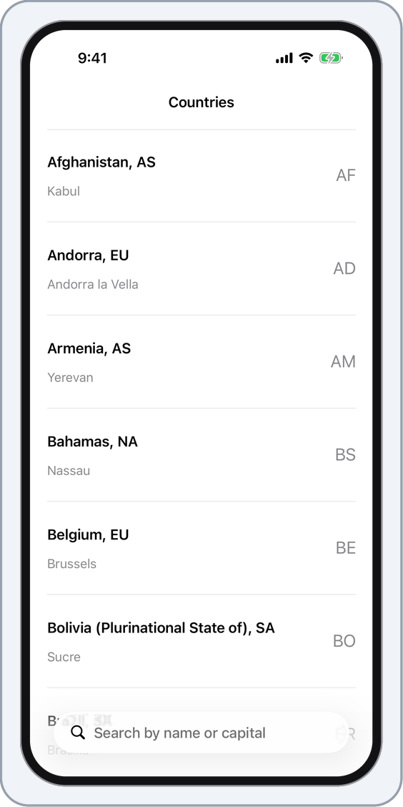
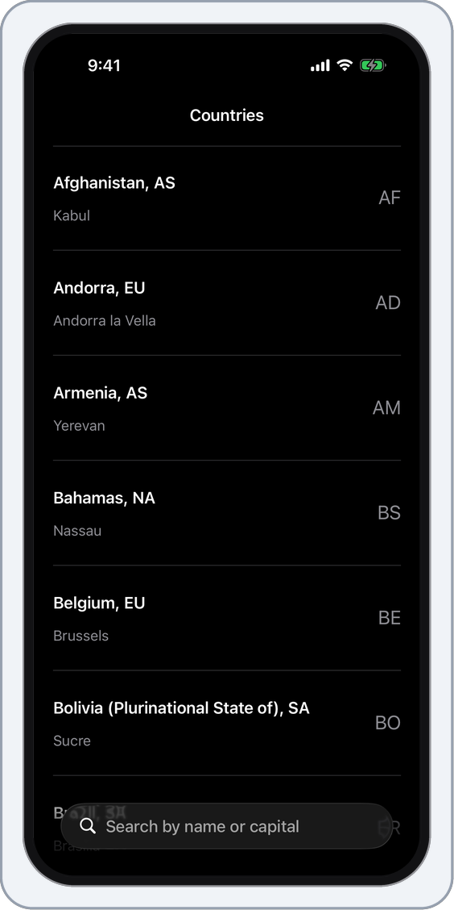
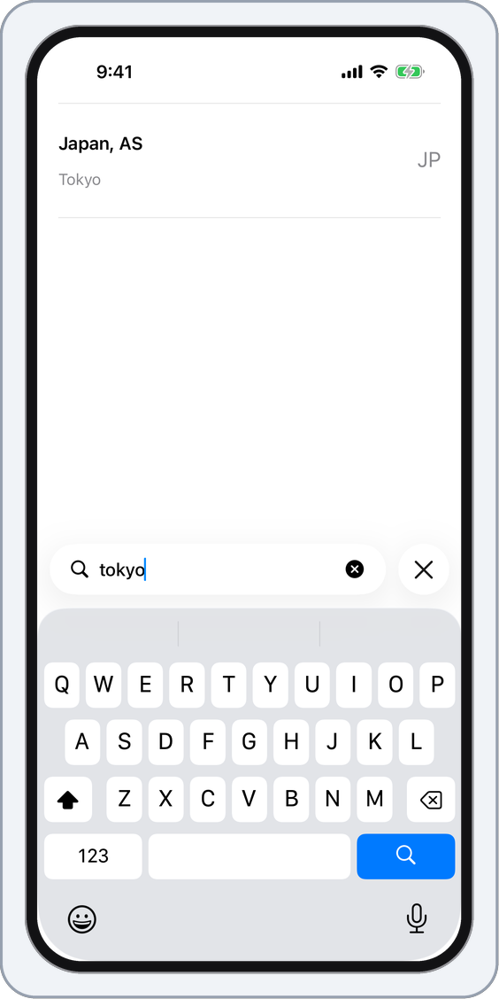
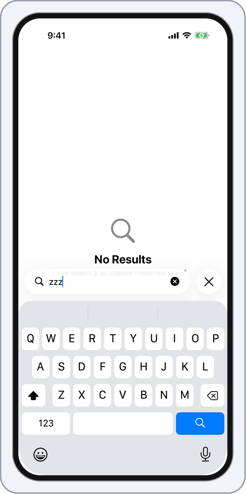
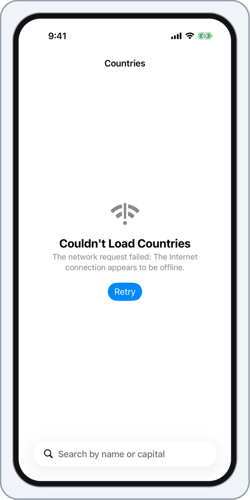
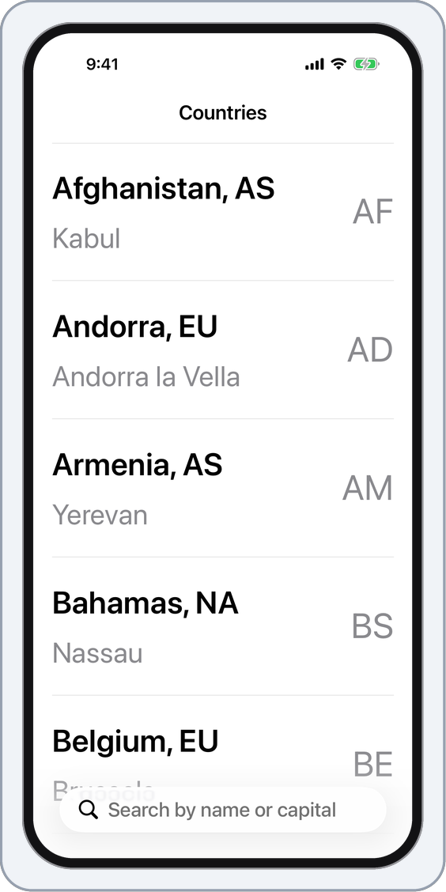
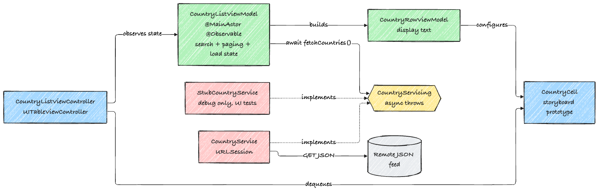

# Countries

A small iOS app that lists the countries of the world. You can search by name or by capital. The list comes from a JSON feed and shows 20 rows at a time, loading more as you scroll.

<p align="center">
  
</p>

<p align="center">
  
  
  
</p>
<p align="center">
  
  
  
</p>

Top row: the list, dark mode, a search for "tokyo". Bottom row: no results, the error screen with a Retry button, and larger text.

## How it works

The view controller does very little. It watches the view model and redraws the table when something changes.

The view model keeps the search text, the rows on screen and the load state (idle, loading, loaded or failed). It gets countries from a `CountryServicing`, which is one `async throws` function. The real service uses `URLSession`. The tests use fakes.

<p align="center">
  
</p>

A few details:

- Search ignores case and accents, so "cote" finds Côte d'Ivoire.
- If a refresh fails and there is already a list on screen, the list stays.
- The empty, error and no-results screens use `UIContentUnavailableView`, set as the table's background view. When I used the view controller's `contentUnavailableConfiguration` instead, VoiceOver only said "Empty list".
- The project builds in Swift 6 mode.

## Running it

You need Xcode 16 or newer and an iOS 18.4 simulator. I built and tested it with Xcode 27.2.

```sh
git clone https://github.com/makambo13/Walmart.git
open Walmart/walmart.xcodeproj
```

Pick the `walmart` scheme and a simulator, then Run.

## Tests

```sh
xcrun simctl list devices available     # pick a simulator id
xcodebuild test -project walmart.xcodeproj -scheme walmart \
  -destination "platform=iOS Simulator,id=<SIMULATOR_ID>"
```

The unit tests use Swift Testing. They cover:

- decoding, including records with missing fields
- the network service, with a `URLProtocol` stub: request details, HTTP errors, bad JSON, being offline
- the view model: paging, search by name and capital, accents, no results, a failed load, Retry, and a second load while one is already running

The UI tests use XCUITest and run the real app against a small list that ships in the Debug build. They scroll to load more rows, search by name, capital and accents, check the no-results screen, cancel a search, and fail a load and press Retry.

Debug builds understand two launch arguments, which is how the UI tests avoid the network:

- `-UITestStubFeed` serves `StubCountries.json` instead of the real feed
- `-UITestFailFirstLoad` does the same, but the first request fails

## Driving the app from the command line

`scripts/record-tour.sh` boots a simulator with `xcrun simctl`, installs and launches the app, switches light and dark mode and text size, and takes screenshots. It then records the screen while `xcodebuild` runs a slow UI test that scrolls and searches. `simctl` can't tap or type, so that part is XCUITest. The screenshots and GIF above were made this way.

```sh
scripts/record-tour.sh <SIMULATOR_ID> captures
```

## Layout

```
walmart/
  App/           app and scene delegates, picks the service
  Models/        Country
  Services/      CountryServicing, CountryService, StubCountryService (Debug only)
  ViewModels/    CountryListViewModel, CountryRowViewModel
  Views/         CountryListViewController, CountryCell
  Resources/     StubCountries.json
walmartTests/    unit tests and fakes
walmartUITests/  UI tests and the guided tour
scripts/         record-tour.sh
docs/            images used here
```
